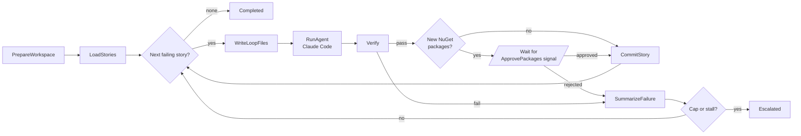

# Spec-to-PR Agent Orchestrator

A durable .NET orchestrator that takes a written spec and drives [Claude Code](https://docs.claude.com/en/docs/claude-code) to implement it, story by story, until every acceptance test passes. [Temporal](https://temporal.io) runs the loop, so a run survives worker crashes and restarts and resumes from the last completed step.

## Overview

You write a spec, break it into stories, and write acceptance tests for each story, all in a **target repo**. The orchestrator then runs a [Ralph loop](https://ghuntley.com/ralph/) over those stories:

1. Pick the highest-priority story that doesn't pass yet.
2. Run Claude Code once, headless, with a fresh context and a prompt for that story.
3. Verify the result independently: build, the story's tests, the full suite, and a check that no locked file was touched.
4. If it passes, the orchestrator commits it, one commit per story. If it fails, an LLM summarizes the failure into `last_failure.md` for the next attempt.

The run ends when every story passes (`Completed`), or when a story runs out of attempts, the run hits its iteration cap, or a story fails the same way twice in a row (`Escalated`).

All work happens on a `ralph/<featureId>` branch in a separate git worktree. Your checkout of the target repo is never changed.



### Key design choices

- **Temporal is the only orchestrator.** Claude Code is a CLI process started by an activity, and it knows nothing about Temporal.
- **The workflow owns story status.** `status.json` is a copy the orchestrator writes. The agent writes only code and `progress.md`.
- **The orchestrator decides what passes, not the agent.** Verification is a separate activity that parses TRX test results. Commits are made by the orchestrator.
- **Locked inputs.** An iteration fails if it touches `spec.md`, `stories.json`, `acceptance/`, `status.json` or `last_failure.md`.
- **A human approves dependencies.** A passing iteration that adds NuGet packages waits for a human decision before it is committed.
- **Small payloads.** Only paths, SHAs and ids go through Temporal. Logs and file contents stay on disk.
- **Optional tracing.** One Langfuse trace per run, with cost, tokens and scores (see [Observability](#observability-langfuse)).

The full design notes and decision records are in [docs/AGENTS.MD](docs/AGENTS.MD).

## Project layout

```
src/
  Orchestrator.Contracts/    Workflow and activity inputs/outputs (records only)
  Orchestrator.Workflows/    FeatureWorkflow and the Ralph loop policy (deterministic code only)
  Orchestrator.Activities/   Claude Code runner, git/worktree, stories, verify, failure summarizer, telemetry
  Orchestrator.Worker/       Generic Host + Temporal worker, configuration, OpenTelemetry
tests/
  Orchestrator.Workflows.Tests/    Workflow tests in Temporal's time-skipping environment, activities mocked
  Orchestrator.Activities.Tests/   Parsers, CLI argument building, git, verification, Langfuse scores
docs/AGENTS.MD               Design notes and decisions
```

## Setup

### Prerequisites

Install these and make sure they are on `PATH`. The worker checks for `git`, `dotnet` and the Claude CLI at startup and exits if any is missing.

| Tool | Check | Notes |
|---|---|---|
| .NET 10 SDK | `dotnet --version` | |
| git | `git --version` | |
| Temporal CLI | `temporal --version` | Provides the local dev server. |
| Claude Code CLI | `claude --version` | Signed in, or `ANTHROPIC_API_KEY` set. |

You also need an Anthropic API key for the failure summarizer. It is read from the environment only:

```powershell
$env:ANTHROPIC_API_KEY = "sk-ant-..."
```

### Configure the worker

Settings are in [src/Orchestrator.Worker/appsettings.json](src/Orchestrator.Worker/appsettings.json). Put machine-specific values in `appsettings.Development.json` next to it, which git ignores, or in environment variables named `Orchestrator__<Setting>`.

`WorkRoot` is the only required setting. Point it at a folder **outside** the target repo:

```json
{
  "Orchestrator": {
    "WorkRoot": "D:\\temporal-runs"
  }
}
```

| Setting | Default | Meaning |
|---|---|---|
| `WorkRoot` | *(required)* | Worktrees go in `{WorkRoot}/{workflowId}`, raw logs in `{WorkRoot}/logs/{workflowId}`. |
| `TemporalAddress` | `localhost:7233` | Temporal frontend. |
| `Namespace` | `default` | Temporal namespace. |
| `ClaudeCliPath` | `claude.cmd` (Windows) / `claude` | Claude Code executable. |
| `AgentModel` | `sonnet` | Model Claude Code uses. |
| `MaxBudgetUsdPerRun` | `2.0` | Spending cap for one agent run. |
| `MaxTurns` | `50` | Turn cap for one agent run. |
| `AllowedTools` | Read, Edit, Write, Glob, Grep, `dotnet build/test/add package` | Tools the agent may use. |
| `SummarizerModel` | `claude-haiku-5-5` | Model that writes `last_failure.md`. |
| `RawLogTailBytes` | `16384` | Raw-log tail used when the summarizer is unavailable. |

The launch profile sets `DOTNET_ENVIRONMENT=Development`, so `dotnet run` picks up `appsettings.Development.json`.

### Build and test

```powershell
dotnet build
dotnet test
```

## Preparing a target repo

The agent works on a separate local git repo. For each feature, commit these files at the commit you will start from:

```
specs/<featureId>/
  spec.md          # what to build, written by a human
  stories.json     # the stories, each with at least one test id
  acceptance/      # acceptance tests for every story, written before the run
```

Example `stories.json`:

```json
{
  "featureId": "f1",
  "stories": [
    {
      "id": "S1",
      "title": "Health endpoint",
      "priority": 1,
      "acceptanceCriteria": ["GET /health returns 200"],
      "testIds": ["Retail.Acceptance.Tests.HealthTests.Returns_ok"]
    }
  ]
}
```

- `featureId` must match the workflow input, and story ids must be unique.
- `testIds` are `Namespace.Class.Method`, matched against the TRX test results.
- The acceptance test project must be part of the solution, because verification runs `dotnet test` from the repo root.
- Tests of stories not reached yet are expected to fail, and the full-suite check ignores them.

## Running a feature

### 1. Start Temporal

```powershell
temporal server start-dev
```

The server listens on `localhost:7233` and the UI is at http://localhost:8233.

### 2. Start the worker

In a second terminal, with `ANTHROPIC_API_KEY` set (and the Langfuse keys, if you want traces):

```powershell
dotnet run --project src/Orchestrator.Worker
```

The worker polls the `orchestrator` task queue. One worker serves every feature and repo, so leave it running.

### 3. Start the workflow

Write the input to a file. Windows PowerShell 5.1 strips the quotes from inline JSON passed to native programs, so `--input '{...}'` fails there.

```powershell
@'
{"repoPath":"D:\\temporal-work","specPath":"specs/f1/spec.md","baseCommitSha":"<sha>","featureId":"f1"}
'@ | Set-Content -Encoding ascii feature-f1.json

temporal workflow start `
  --task-queue orchestrator `
  --type FeatureWorkflow `
  --workflow-id feature-f1 `
  --input-file feature-f1.json
```

| Field | Required | Meaning |
|---|---|---|
| `repoPath` | yes | Absolute path to the local target repo. |
| `specPath` | yes | Repo-relative path to the spec. |
| `baseCommitSha` | yes | Commit to branch from (`git -C <repoPath> rev-parse HEAD`). It must contain `specs/<featureId>/`. |
| `featureId` | yes | Matches `specs/<featureId>/`. |
| `maxAttemptsPerStory` | no | Default `3`. |
| `maxTotalIterations` | no | Default `20`. |

Use a new workflow id for each run. The id also names the worktree folder.

### 4. Follow progress

Changes appear in the worktree, not in your checkout of the target repo.

| What | Where |
|---|---|
| Activity timeline | Temporal UI → http://localhost:8233 → your workflow id |
| Current activity and heartbeat | `temporal workflow describe --workflow-id feature-f1` |
| Story pass/fail state | `{WorkRoot}/feature-f1/.ralph/f1/status.json` |
| One commit per passing story | `git -C {WorkRoot}/feature-f1 log --oneline` |
| Agent notes | `{WorkRoot}/feature-f1/.ralph/f1/progress.md` |
| Last failure feedback | `{WorkRoot}/feature-f1/.ralph/f1/last_failure.md` |
| Raw agent, build and test output | `{WorkRoot}/logs/feature-f1/` |
| Final result | `temporal workflow result --workflow-id feature-f1` |

`Escalated` results include the reason (`MaxAttemptsPerStory`, `MaxTotalIterations` or `Stalled`), the story, and the paths to the last summary and raw log.

### 5. Approve or reject new packages

When an iteration passes but adds or changes NuGet packages, the workflow waits until you decide. It waits indefinitely, and the worker logs a warning.

```powershell
# What is waiting?
temporal workflow query --workflow-id feature-f1 --name PendingPackageApproval

# Approve
'{"approved":true}' | Set-Content -Encoding ascii decision.json
temporal workflow signal --workflow-id feature-f1 --name ApprovePackages --input-file decision.json

# Reject. The comment goes to the agent's next attempt.
'{"approved":false,"comment":"Use System.Text.Json instead"}' | Set-Content -Encoding ascii decision.json
temporal workflow signal --workflow-id feature-f1 --name ApprovePackages --input-file decision.json
```

### 6. Merge the result

`ralph/<featureId>` is a normal branch in the target repo. When the run completes, merge it from your own checkout and remove the worktree:

```powershell
cd <repoPath>
git checkout master
git merge --ff-only ralph/f1          # or --no-ff for a merge commit
git worktree remove <WorkRoot>\feature-f1
git branch -d ralph/f1
```

The branch also contains `.ralph/<featureId>/`, the loop's working files. Keep it as a record of the run, or `git rm -r .ralph` after merging.

### Stopping, resuming and rerunning

- **Stop and resume:** stop the worker with Ctrl+C at any time and start it again. The workflow resumes from the last completed activity. Activities are idempotent, so retries never create duplicate worktrees, branches or commits.
- **Abandon a run:** `temporal workflow terminate --workflow-id feature-f1 --reason "abandoned"`.
- **Rerun a feature from scratch:** remove the worktree **and** delete the branch. `PrepareWorkspace` reuses an existing `ralph/<featureId>` branch, so a rerun on the old branch would start from the finished code.

  ```powershell
  git -C <repoPath> worktree remove <WorkRoot>\feature-f1
  git -C <repoPath> branch -D ralph/f1
  ```

  Then start the workflow again, preferably with a new workflow id (for example `feature-f1-r2`).

## Observability (Langfuse)

The worker can export traces to [Langfuse](https://langfuse.com) over OpenTelemetry. Tracing is off unless both keys are set **in the worker's environment before it starts**:

```powershell
$env:Langfuse__PublicKey = "pk-lf-..."
$env:LANGFUSE_SECRET_KEY = "sk-lf-..."                        # environment only, never in config
$env:Langfuse__BaseUrl   = "https://cloud.langfuse.com"       # must match your project's region
dotnet run --project src/Orchestrator.Worker
```

| Setting | Default | Meaning |
|---|---|---|
| `Langfuse:BaseUrl` | `https://cloud.langfuse.com` | Langfuse instance, e.g. `https://us.cloud.langfuse.com` or a self-hosted URL. |
| `Langfuse:PublicKey` | *(empty: tracing off)* | Project public key. |
| `Langfuse:CaptureContent` | `true` | Also send summarizer prompts/responses and the agent's final result text. |
| `Langfuse:Environment` | `development` | Langfuse environment name. |

What you get:

- **One trace per workflow run**, grouped under a session named after the workflow id. Activity spans are tagged with `featureId`, `storyId` and `iteration`.
- **A `claude-code` generation for each agent run**, with the model, tokens, turns, exit code and the cost reported by the CLI.
- **A generation for each failure summary.**
- **Scores:** `verify_passed` on each Verify span, plus `feature_outcome`, `iterations`, `stories_passed_ratio` and `escalation_reason` on the trace.

Telemetry never fails a run. If Langfuse is unreachable, spans are dropped and score errors are only logged.

## Development rules

- Workflow code must be deterministic: no `DateTime.Now`, `Guid.NewGuid`, `Random`, I/O or `Task.Run` in `Orchestrator.Workflows`. All side effects go in activities.
- Activities must be safe to retry. Key them on workflow id + story id + iteration.
- Long activities (`RunAgent`, `Verify`) heartbeat and have explicit timeouts.
- No secrets in the repo. API keys come from environment variables.
- Run `dotnet build` and `dotnet test` before committing.
